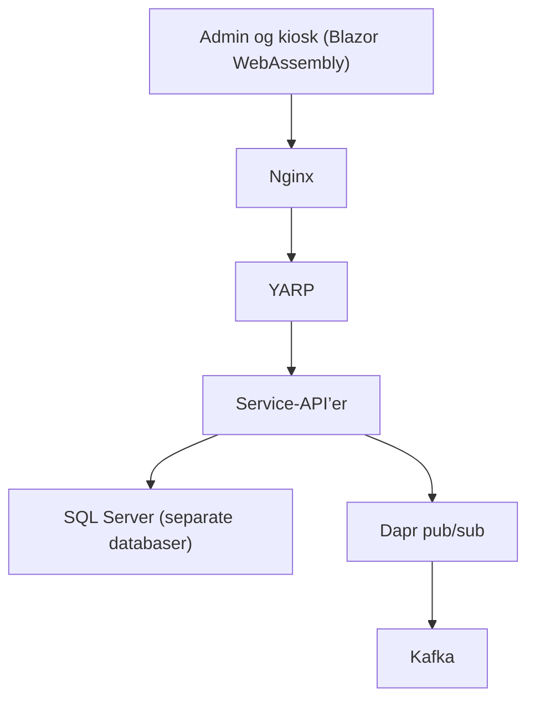

# VidensVejen

VidensVejen er vores eksamensprojekt på 3. semester. Løsningen er udviklet til interaktive udstillinger med fakta og quizzer. I adminfrontenden opretter og vedligeholder medarbejdere udstillinger og quizzer. Kioskfrontenden er den planlagte indgang for besøgende.

## Kom i gang

### Docker Compose

1. Sørg for, at Docker og Docker Compose kører, og at du har adgang til de containerimages fra GitHub Container Registry, som Compose-filen bruger.
2. Opret `.env` i repoets rod efter [miljøvariablerne nedenfor](#miljøvariabler-til-docker-compose). Udfyld også adminvariablerne, så du kan logge ind.
3. Læg de certifikater og private nøgler, som frontendens Nginx-konfiguration læser, i mappen `certs/`. Compose monterer mappen i begge frontendcontainere.

   | Frontend | Certifikat | Privat nøgle |
   | --- | --- | --- |
   | Admin | `frontend_admin.crt` | `frontend_admin.key` |
   | Kiosk | `frontend_kiosk.crt` | `frontend_kiosk.key` |

4. Start løsningen fra repoets rod, og kontrollér containerstatus.

   ```bash
   docker compose up -d
   docker compose ps
   ```

5. Åbn [adminfrontenden](https://localhost:8091/login) og [kioskfrontenden](https://localhost:8191/). Ved kørsel på en anden maskine skal du bruge dens værtsnavn.

Opstartsseedingen dækker AuthService og UserService. På en tom installation skal databaser til de øvrige funktioner, du vil afprøve, også klargøres med deres migrationer, hvor de findes.

### Lokal udvikling med Aspire

Brug .NET 10 SDK, Docker og Dapr CLI. Start AppHost fra repoets rod.

```bash
dotnet run --project VidensVejen/VidensVejen.AppHost --launch-profile https
```

Åbn [Aspire-dashboardet](https://localhost:17143) for at se API-adresser, status og logge. AppHost bruger [port 7237 til admin](https://localhost:7237) og [port 7296 til kiosken](https://localhost:7296).

`.env`-opsætningen ovenfor gælder Docker Compose. Brug lokal .NET-konfiguration til de værdier, API’erne skal bruge under Aspire, herunder JWT og eventuelt `BootstrapAdmin:Email` og `BootstrapAdmin:Password` til AuthService. UserService skal have samme `BootstrapAdmin:Email` for at oprette adminprofilen.

## Prøv løsningen

1. Log ind i adminfrontenden med den konfigurerede adminmail og startadgangskode.
2. Åbn **Opret udstilling** på `/exhibition/create`. Giv udstillingen et navn, tilføj et temabillede, og udfyld indholdet.
3. Åbn **Opret quiz** på `/games/create`. Vælg udstillingen, tilføj spørgsmål og svarmuligheder, og vælg **Kontrollér kladde**.
4. Publicér en quizkladde via GameService med `POST /v1/games/quiz-drafts/{id}/publish`. Brug kladdens ID i ruten, og gem det quiz-ID, API’et returnerer.
5. Start quizrunden via GameService. Send `POST /v1/games/sessions` med quizzens ID. Brug sessionens ID i `POST /v1/games/sessions/{id}/answers` for at afgive et svar og se den feedback, som GameService returnerer.

Kioskens forside er stadig en pladsholder i den aktuelle version. Quizrunden i demoen afprøves derfor via API’et.

## Arkitektur



Diagrammet viser Docker Compose-opsætningen. YARP videresender API-kald til AuthService, UserService, ExhibitionService, GameService, ImageService og StatisticsService. Dapr bruger Kafka til de integrationsbeskeder, der sendes via pub/sub.

AuthService og UserService bruger Outbox og Inbox til brugerhændelser. Outbox gemmer hændelsen sammen med databaseændringen, så den kan publiceres bagefter. Inbox registrerer event-ID’et, så samme hændelse kan genkendes ved genlevering. AuthService udsteder JWT’er, og adminrettigheder repræsenteres som permission-claims.

## API-dokumentation og tests

- **Scalar** findes på `/scalar/v1` på det enkelte API i `Development`. Brug API’ets adresse fra Aspire-dashboardet. OpenAPI-dokumentet findes på `/openapi/v1.json`.
- **Postman** kan bruges med projektets separate samling `VidensVejen-API.postman_collection.json`. Importér den og brug adressen til YARP eller det relevante API, alt efter requestets rute.
- **Tests** ligger i `VidensVejen/tests/`. Domæne- og applikationstestene bruger xUnit, og der er særskilte testprojekter til begge Blazor-frontends.

Kør løsningens testprojekter fra repoets rod med .NET 10 SDK.

```bash
dotnet test --solution VidensVejen/VidensVejen.slnx
```

## Miljøvariabler til Docker Compose

Opret en `.env` ved siden af `docker-compose.yaml` med indstillingerne til jeres miljø. Hold filen uden for versionsstyring, da den indeholder adgangskoder og JWT-nøglen.

### SQL Server

| Database | SA-adgangskode til SQL Server-containeren | Connection string til API’et |
| --- | --- | --- |
| User | `USERDB_SA_PASSWORD` | `USER_DB_CONNECTION_STRING` |
| AuthUser | `AUTHUSERDB_SA_PASSWORD` | `AUTHUSER_DB_CONNECTION_STRING` |
| Exhibition | `EXHIBITIONDB_SA_PASSWORD` | `EXHIBITION_DB_CONNECTION_STRING` |
| Game | `GAMEDB_SA_PASSWORD` | `GAME_DB_CONNECTION_STRING` |
| Statistics | `STATISTICSDB_SA_PASSWORD` | `STATISTICS_DB_CONNECTION_STRING` |
| Image | `IMAGEDB_SA_PASSWORD` | `IMAGE_DB_CONNECTION_STRING` |

Compose kræver, at alle seks connection strings er udfyldt. Brug SQL Server-containerens servicenavn og interne port i connection stringen, fx `Server=mssql-UserDb,1433` for UserService. Hvis connection stringen bruger `sa`, skal adgangskoden svare til den, SQL Server er sat op med.

### JWT

| Variabel | Bruges til |
| --- | --- |
| `JWT_KEY` | Hemmelig nøgle til at signere og validere JWT’er. |
| `JWT_ISSUER` | Udstederen, der sættes på og valideres i JWT’er. |
| `JWT_AUDIENCE` | Den målgruppe, der sættes på og valideres i JWT’er. |

Compose sender de samme JWT-værdier til AuthService og de øvrige services, der bruger JWT.

### Standardadminkonto

Sæt disse variabler i `.env` ved siden af `docker-compose.yaml` for at aktivere den automatiske oprettelse af en adminkonto.

| Variabel | Bruges til |
| --- | --- |
| `BOOTSTRAP_ADMIN_EMAIL` | Mailadresse til adminlogin og brugerprofil. Vælg en adresse, der er ledig i begge databaser. |
| `BOOTSTRAP_ADMIN_PASSWORD` | Startadgangskode til adminkontoen. AuthService kræver den, når kontoen oprettes, og gemmer kun dens hash. |

Når adminmailen er sat, anvender AuthService og UserService hver deres manglende EF Core-migrationer ved opstart. AuthService opretter den aktive adminkonto og tildeler alle permissions fra sin database. UserService opretter profilen **Admin VidensVejen** med samme bruger-ID og mailadresse.

Ved senere opstarter beholder kontoen sin eksisterende adgangskode, og AuthService tilføjer eventuelle manglende permissions. Hvis adminmailen er tom eller udeladt, springer begge services denne opstartsrutine over.

## Portmapping

| Service | Adresse på værten | Containerport | Protokol |
| --- | --- | ---: | --- |
| `VidensVejen-Frontend-Admin` | `localhost:8090` | `80` | HTTP |
| `VidensVejen-Frontend-Admin` | `localhost:8091` | `443` | HTTPS |
| `VidensVejen-Frontend-Kiosk` | `localhost:8190` | `80` | HTTP |
| `VidensVejen-Frontend-Kiosk` | `localhost:8191` | `443` | HTTPS |
| `mssql-UserDb` | `127.0.0.1:9001` | `1433` | SQL Server |
| `mssql-AuthUserDb` | `127.0.0.1:9002` | `1433` | SQL Server |
| `mssql-ExhibitionDb` | `127.0.0.1:9003` | `1433` | SQL Server |
| `mssql-GameDb` | `127.0.0.1:9004` | `1433` | SQL Server |
| `mssql-StatisticsDb` | `127.0.0.1:9005` | `1433` | SQL Server |
| `mssql-ImageDb` | `127.0.0.1:9006` | `1433` | SQL Server |

Frontendportene er publiceret på alle værtsmaskinens netværksinterfaces. SQL Server-portene er bundet til `127.0.0.1` og kan derfor kun tilgås fra selve værtsmaskinen via de viste værtsporte.

YARP-proxyen og API-services lytter på port `8080` internt i Docker. Kafka bruger `kafka-broker:9092` internt. Compose-filen publicerer ingen værtsporte for disse services.
